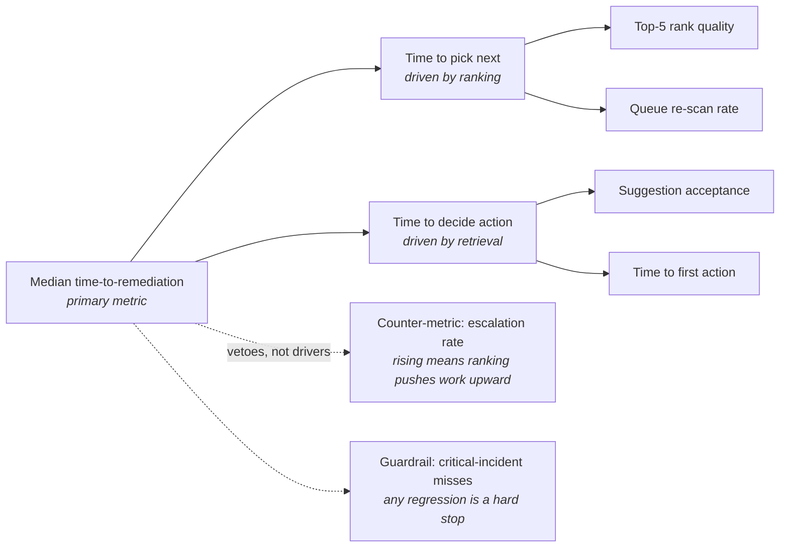
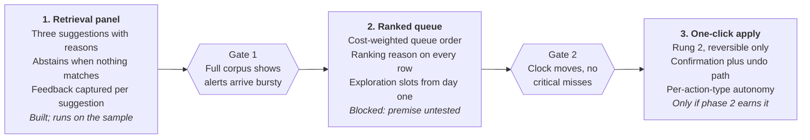

# Alert Triage Copilot — Product Brief

*An AI recommendation layer for network operations triage. Portfolio project; built entirely on public data.*

Last updated 11 October 2026.

## Summary

Alert Triage Copilot ranks a network operations alert queue and, for the alert an engineer opens, retrieves what was done the last time something looked like this. The bet: in operations, the scarce resource is not detection but attention and recall, and a recommender that respects the asymmetric cost of being wrong is worth more than one that maximises relevance.

Two recommendation problems sit behind one screen. Ranking decides what an on-call engineer sees first. Retrieval surfaces prior remediations for the incident in front of them. They share a surface and almost nothing else — different inputs, different evaluation, different ways of failing.

This is a portfolio project. It uses public log data only, with a clearly labelled synthetic layer for remediation history, which no public dataset contains. No proprietary or employer data is used anywhere in it.

## Problem

A network operations centre receives far more alerts in a shift than anyone can work, and the queue arrives ordered by arrival time and a severity field the sending device assigned without context. Severity is a property of the device, not of the network: a flapping interface on a lab switch and the same event on a transit link look identical in the queue.

So the engineer orders the queue by hand, from memory, under time pressure. Two errors follow, and they cost very differently. Working a low-impact alert while a service degrades silently can run to hours of customer impact. Escalating something routine at 03:00 costs one engineer's night. A system that treats those as the same mistake will be tuned to the wrong point.

The second loss is quieter. Most incidents resemble something the team has already solved, but that knowledge lives in ticket comments, chat threads and the heads of the three people who have been there longest. There is no path from "this looks familiar" to "here is what we did and whether it worked". New engineers rediscover fixes that exist; experienced ones become single points of failure.

The gap is not detection. Monitoring already finds more than anyone can act on. The gap is ordering attention and recalling what worked.

## Users

The on-call NOC engineer is the primary user and the only one the v1 screen is designed for. The others are stakeholders whose needs shape constraints, not UI.

| User | Context | Job to be done | What failure looks like |
| --- | --- | --- | --- |
| On-call NOC engineer | Mid-shift, 200–400 open alerts, often alone at night | Decide what to work next, and resolve it without waking anyone | Works the wrong thing first; escalates out of uncertainty |
| Escalation / SME engineer | Pulled in by page, limited context | Understand the incident fast enough to act | Paged for something the on-call could have handled |
| Ops manager | Weekly review, not in the incident | Know whether triage quality is improving and where the gaps are | Cannot distinguish a quiet week from a missed incident |

The design centre of gravity is the engineer at 03:00 with no one to ask. That person does not want a model's opinion stated as fact; they want a shortlist, the reason behind it, and a fast way to reject it.

## Two recommendation problems

The screen looks like one feature and is two. Conflating them is the most common way this product gets built badly, because a single model tuned for queue ranking will produce confident, useless remediation suggestions.

| | Ranking the queue | Retrieving prior remediations |
| --- | --- | --- |
| Question | What should I work on next? | What did we do last time? |
| Input | Alert attributes, topology position, recent history | The selected incident's signature plus a case base |
| Output | An ordered list, refreshed continuously | Three candidate actions with reasons |
| Feedback | Implicit and biased — engineers mostly work from the top | Explicit — the action was taken or it was not |
| Primary failure | A critical alert buried below the fold | A plausible, confidently wrong action |
| Cost of that failure | Prolonged customer impact | Engineer acts on bad advice, or stops trusting the panel |

Ranking is the conventional half: a learned ordering over a stream, with all the usual position-bias problems. Retrieval is the half worth building, because it is where the institutional knowledge loss actually happens and where almost no product does anything useful today.

They also fail at different times. Ranking degrades gradually as traffic patterns drift. Retrieval fails sharply and precisely when the incident is novel — which correlates with the incidents that matter most.

## V1 scope

One screen. A ranked incident queue on the left; selecting an incident opens a panel with up to three suggested actions, each carrying a one-line reason in plain language and a confidence band, plus the evidence it was drawn from.

In scope:

- Ranked queue, re-scored as alerts arrive, with the ranking reason visible on each row
- Suggested-actions panel: three candidates maximum, each with reason, confidence band and links to the prior incidents behind it
- Explicit feedback on each suggestion — used, not used, wrong — captured in one click
- An unranked view the engineer can switch to at any time, and which the experiment uses as control

Explicitly out of scope for v1, and each for a reason:

- **Executing remediations.** Suggestion only. Trust has to be earned before the product touches the network.
- **Alert correlation and deduplication.** A real adjacent problem, a different product, and bundling it would make the experiment unreadable.
- **Root cause analysis.** The panel says what was done before, not why the incident happened. Claiming causality the data cannot support is the fastest way to lose the user.
- **Mobile.** Triage happens at a desk with multiple screens.

Non-goals worth stating plainly: this does not aim to reduce alert volume, replace the monitoring stack, or let a less experienced engineer handle incidents beyond their level. The last one matters — if the panel starts functioning as a substitute for competence rather than a shortcut for a competent person, that is a failure mode, not adoption.

## Trust and the automation ladder

Autonomy is earned per rung, and the right to move up is defined before shipping rather than argued afterwards. V1 ships on rung 1 and does not leave it inside the first phase.

| Rung | What the system does | Evidence required to enter | What sends it back down |
| --- | --- | --- | --- |
| 1. Suggest | Shows ranked queue and up to 3 candidate actions; engineer does everything | None — this is the starting point | Suggestion-acceptance below 20%, or engineers switching to the unranked view by default |
| 2. Suggest and apply | Same, plus one-click execution of a suggested action with a confirmation step and an undo path | Top-1 suggestion accepted in 60%+ of resolved incidents over 500+ incidents, and zero critical misses attributable to ranking | Any applied action that worsens an incident; acceptance falling below 50% |
| 3. Auto-remediate and notify | Executes a narrow allowlist of reversible actions automatically, notifies after the fact | Rung 2 stable for a quarter; per-action-type accuracy above 95% on that allowlist; a tested rollback for every action on it | One unreviewed auto-action with customer impact — immediate return to rung 2 for that action type |

Two principles hold across all three rungs. Demotion is automatic and does not require a debate: the thresholds above are committed in advance, and crossing one reverts the rung while the cause is investigated. And autonomy is granted per action type, not globally — restarting a BGP session and reconfiguring a routing policy do not earn the same trust because the model did well on the first.

The reason to publish the ladder before building is that it converts a vague question ("is the AI good enough?") into a measurable one, and it gives the user a readable promise about what the system will and will not do without them.

## Data and cold start

One public source, used within a stated boundary. Loghub's datasets are research-use with citation requirements, so the project cites them and stays non-commercial.

**Scope limit, stated up front.** This build uses the 2,000-line BGL sample that Loghub publishes on GitHub, not the full 4,747,963-line corpus, which is distributed through Zenodo. That sample is thinned across the full 214-day span rather than contiguous, which makes it sound for questions about signature structure and useless for questions about volume. Everything below respects that line.

| Source | What it provides | Used here | Terms |
| --- | --- | --- | --- |
| [Loghub BGL sample](https://github.com/logpai/loghub) | Blue Gene/L supercomputer log, alert and non-alert messages labelled. 2,000 lines, thinned across 214 days | Everything in this build: signatures, coverage, cold start, the case base | Research use; cite the Loghub paper |
| [Loghub BGL, full](https://github.com/logpai/loghub) | The same log at 4,747,963 lines, contiguous. On Zenodo, not used here | Nothing yet. Required for arrival rate, burstiness, and the drift question | Research use; cite the Loghub paper |
| [UNSW-NB15](https://research.unsw.edu.au/projects/unsw-nb15-dataset) | Labelled network traffic, 10 classes across 49 features | Not used in this build. Candidate second corpus for cross-domain retrieval | Free for academic research in perpetuity; five papers to cite |

This is a supercomputer RAS log, not carrier network telemetry. That substitution is a real limitation and the brief states it rather than glossing it: the structural properties that matter here — class imbalance, bursty arrival, sparse labels, repeated signatures — are present, but conclusions about absolute performance would not transfer to a production NOC.

**The synthetic layer.** No public dataset records what an engineer did in response to an alert, which is exactly the retrieval problem's training signal. So remediation history is generated: a rules model maps alert signatures to plausible actions, with realistic noise — wrong first attempts, actions that were taken but did not help, and inconsistency between engineers. It is labelled synthetic everywhere it appears, in the code and in the write-up. A synthetic layer that is declared is a reasonable modelling choice; one that is quiet is a credibility problem.

**Cold start is the central design problem, not an edge case.** Retrieval has nothing to offer when an incident has no precedent — and novel incidents skew high-severity, so the system is least useful exactly when the stakes are highest. Three responses:

1. **Say so.** When nearest-neighbour similarity falls below threshold, the panel states that this looks unlike anything in the case base, and shows nothing else. An empty answer beats a confident bad one, and flagging novelty is itself information an engineer can act on.
2. **Fall back to content, not history.** An LLM reasoning over alert text, affected component and topology position can propose a diagnostic first step with no interaction history at all. This is the defensible use of a language model here — a place where collaborative filtering has literally nothing to work with.
3. **Rank novelty up.** An incident with no precedent is routed toward a senior engineer rather than buried, inverting the usual recommender instinct to favour the familiar.

New-item cold start has a cheaper fix: a newly deployed device inherits the case base of its device class and role until it accumulates its own history.

### First findings, and a correction

Run on the 2,000-line BGL sample, 11 October 2026. Small, thinned, and not yet conclusive — but it already changed a design assumption.

**The correction.** An initial pass reported that 83% of alerts had a prior precedent, which looked like a clean green light for retrieval. That measurement was wrong for the product's purpose: it checked each alert against everything before it in one cumulative pass, which quietly let early-period signatures carry the result. Re-run as a chronological split — train on the first 70% of the timeline, test on the last 30%, the only arrangement matching what the system faces in production — coverage fell to **9.3%**. Eight of the nine signatures in the test period had never appeared in training.

**It is not a parsing artifact.** The first suspicion was the signature normaliser: node names in one BGL convention were being collapsed and another left intact, so identical Lustre mount failures counted as separate signatures. Fixing that cut distinct signatures from 24 to 15 and singletons from 58% to 20% of signatures. Coverage did not move. The failure mix genuinely shifted: the training period is dominated by TLB and storage errors, the test period by `ciod` message-prefix and Lustre mount failures.

**What this changes.** Case-base freshness stops being an implementation detail and becomes a product requirement. Three consequences for the design above:

1. The system must know when its own case base is stale, and say so, rather than silently returning nothing for a whole class of incident.
2. Cold start is not a cold-start problem — it recurs. The abstention path and the content-based fallback are load-bearing in steady state, not just at launch.
3. Coverage becomes a primary tracked metric rather than a diagnostic, because it is the early warning that the failure mix has moved.

**What is still unknown.** Forty-three test alerts is too few to conclude from, and Loghub's sample is thinned rather than contiguous, so arrival rate and burstiness cannot be read from it at all. The full 4.7M-line dataset settles both. If drift holds at scale it is the most interesting result in the project; if it dissolves, the original design stands.

## Metrics

Both halves of the product move the same clock by different routes, so one primary metric covers both and each half keeps its own diagnostic underneath.

The two boxes at the bottom do not roll up into the primary metric — they constrain it. A system can always cut median time-to-remediation by encouraging fast, shallow action, and the vetoes are what stop that from counting as success.

**Primary: median time-to-remediation**, measured from alert raised to incident resolved, reported per severity band rather than pooled. Pooling hides the case that matters: a large improvement on routine alerts can mask a regression on critical ones.

**Counter-metric: escalation rate.** If the ranking is good but the suggestions are not trusted, engineers will escalate more rather than act. Time-to-remediation might still fall, because escalation is fast — it just moves the work to someone more expensive. A rise here means the product is shifting load, not reducing it.

**Guardrail: critical-incident miss rate**, defined as a critical incident that sat outside the top 20 of the queue for more than ten minutes. This is the asymmetry made concrete. Any statistically detectable regression stops the rollout regardless of how the primary metric moved — committed before launch, not negotiated after.

Two diagnostics are tracked but not optimised: suggestion acceptance by rung (feeding the ladder thresholds) and coverage, the share of incidents where retrieval returned anything at all. Coverage falling while acceptance rises usually means the case base has narrowed, not that the model improved.

## Experiment design

**Randomise the engineer, not the alert.** The obvious design assigns alerts to treatment or control and compares resolution times. It does not work here. One engineer triages adjacent alerts in one session, so an engineer who sees ranked alerts learns the ranking's logic and applies it to their control alerts too. Treatment leaks into control, the effect shrinks toward zero, and a working product reads as a null result. Assignment is therefore by engineer, for a full rotation, with the unranked queue as control.

That choice is expensive and worth naming as such: the unit of analysis becomes the engineer-shift rather than the incident, so the effective sample size collapses from thousands of alerts to dozens of shifts. A six-week run on a twenty-engineer rotation detects a shift of roughly 15% in median time-to-remediation, not 5%. If the product only moves the metric by 5%, this test cannot tell — which is worth knowing before running it rather than after.

**Offline metrics will not predict this.** Ranking quality measured as NDCG against historical labels assumes the historical ordering was good, which is the premise under test. Offline evaluation is used for one thing only: catching regressions between model versions before they reach anyone. It is never cited as evidence the product works.

**Position bias contaminates the training signal** from day one. Engineers work from the top, so the top of the queue accumulates all the feedback and the model learns that whatever it ranked highly was correct. Mitigation is a small randomised exploration slot — a fixed share of sessions get a deliberately perturbed ordering, which costs a little efficiency and buys unbiased data about what sits below the fold.

**A null result is informative here**, and the brief commits to interpreting it rather than re-cutting the data until something is significant. Three distinguishable outcomes: ranking moves the clock and retrieval does not, which means ship the queue and rethink the panel; retrieval is accepted but the clock does not move, which means the bottleneck is execution, not knowledge; neither moves, which means triage was not the constraint and the problem statement was wrong.

**Rollout:** one volunteer rotation for six weeks, then a second rotation with different seniority to test whether benefit concentrates among junior engineers — plausible, and it changes who the product is for. Stopping rules are the guardrail thresholds from the ladder, checked weekly, with a pre-registered analysis plan so the stopping decision is not made by whoever reads the dashboard first.

## Risks

| Risk | Why it happens | Mitigation | How it shows up first |
| --- | --- | --- | --- |
| Feedback-loop calcification | Engineers act on the top of the queue, the model learns only from what it surfaced, and it converges on last year's failure modes | Randomised exploration slots; coverage tracked as a first-class metric | Coverage falls while acceptance rises |
| Automation complacency | A panel that is usually right trains people to stop checking, so the rare wrong suggestion is followed | Ladder stays at rung 1 through phase 1; confidence bands; evidence links shown, not hidden behind a click | Acceptance near 100% with near-zero "wrong" feedback — too good, meaning nobody is looking |
| Hallucinated remediations | An LLM asked for a plausible action will always produce one, including for incidents it has no basis for | Retrieval grounded in the case base; the LLM path is explicitly labelled as a diagnostic suggestion, never a fix; abstention when similarity is below threshold | Suggested actions that reference devices or commands not in the incident |
| Skill erosion | Junior engineers learn the panel instead of the network | Reasons are shown, not just actions; the panel explains why, which is the part that transfers | Harder to detect — tracked through escalation complexity over quarters, not weeks |
| The problem was not triage | Teams may be bottlenecked on change approval or vendor response, not on knowing what to do | The null-result branch in the experiment design catches this | Retrieval accepted, clock unmoved |

The first two are the ones that would actually kill this product in deployment, and they pull in opposite directions: fixing calcification means showing engineers things the model is unsure about, while fixing complacency means not over-trusting what it is sure about. Both are solved by the same design principle — the system shows its reasoning and its uncertainty rather than just its answer — which is why that principle is in v1 scope rather than deferred as polish.

## Phasing

The original plan shipped ranking first, on the reasoning that it is the cheaper way to test whether triage is the bottleneck. The available data does not support that order. Ranking's whole premise is that alerts arrive faster than they can be worked, and the published sample is thinned rather than contiguous, so it cannot show arrival rate or burstiness at all. Building ranking first would mean building on an assumption this project cannot currently check.

So retrieval goes first, and ranking is gated on evidence that does not exist yet.

Phase 1 is built and runs on the sample. Phases 2 and 3 are drawn but neither is scoped here, and gate 1 is not a product threshold at all — it is a data question. Until the full corpus shows that alerts actually arrive in bursts, ranking stays unbuilt.

That is a smaller product than the brief originally described, and it is the honest one. A retrieval panel that answers "what did we do last time" and says nothing when it does not know is a complete product on its own.

## Open questions

- Does the benefit concentrate among junior engineers? If so, this is a training and onboarding product with different buyers and a different pitch, and the positioning in this brief is wrong.
- Is "similar incident" a property of the alert signature, the affected topology, or the time of day? The retrieval layer's definition of similarity is the single most consequential modelling choice and the brief does not yet commit to one.
- What happens during a major incident, when fifty correlated alerts arrive at once? The queue model assumes independent incidents, which is exactly wrong in the moments that matter most.
- Where is the line between a diagnostic suggestion and clinical-style advice the engineer should not simply follow? Phase 3 needs this answered before it ships, not during.

## What I would do differently

The first version of this scope bundled alert correlation into v1, on the reasoning that correlated alerts are the obvious cause of queue noise. That would have made the experiment unreadable — two mechanisms moving the same metric with no way to attribute the change. Cutting it was right, but it also removed the mitigation for the major-incident question above, which is now an open risk rather than a solved one. That trade is deliberate and would be the first thing to revisit after phase 1.

The first coverage measurement was also wrong in a way worth recording: it used a cumulative walk, which quietly let early-period signatures carry the result. The 83% it produced looked like a green light. The correct chronological split gave 9.3% and pointed at drift. Had I not re-run it, the project would have been built on a number that was never measuring the right thing.

The substitution of supercomputer RAS data for network telemetry is the weakest part of the project and no amount of careful modelling fixes it. If this were real, the first move would be a design partner with real NOC data under NDA, and everything in the brief downstream of the data section would be provisional until then.
